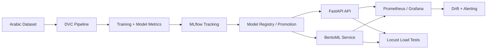
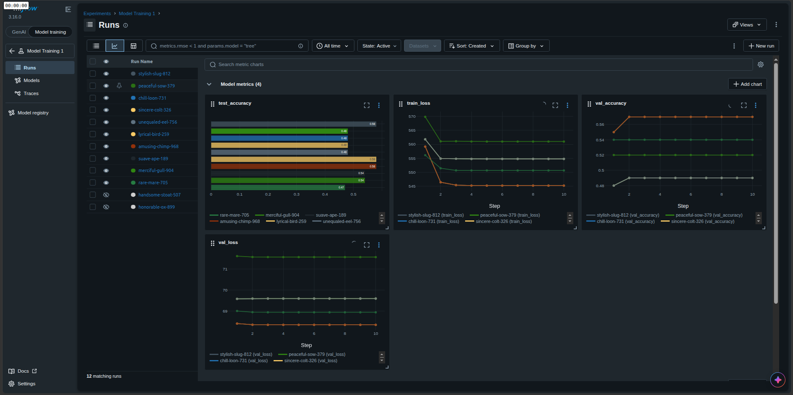
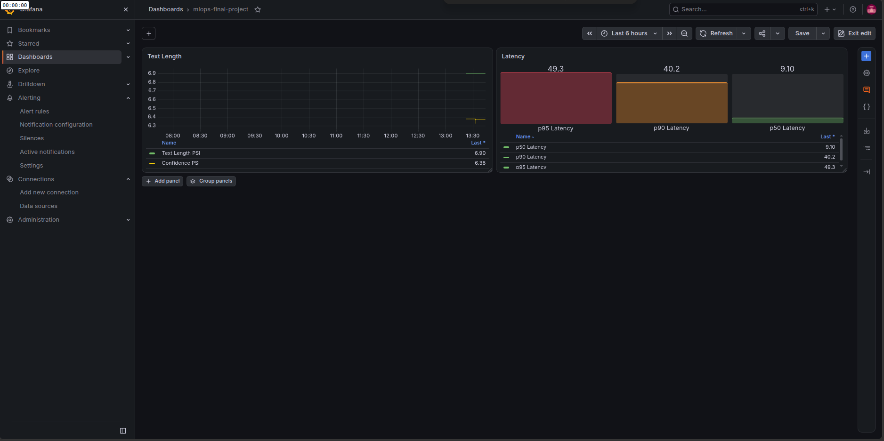
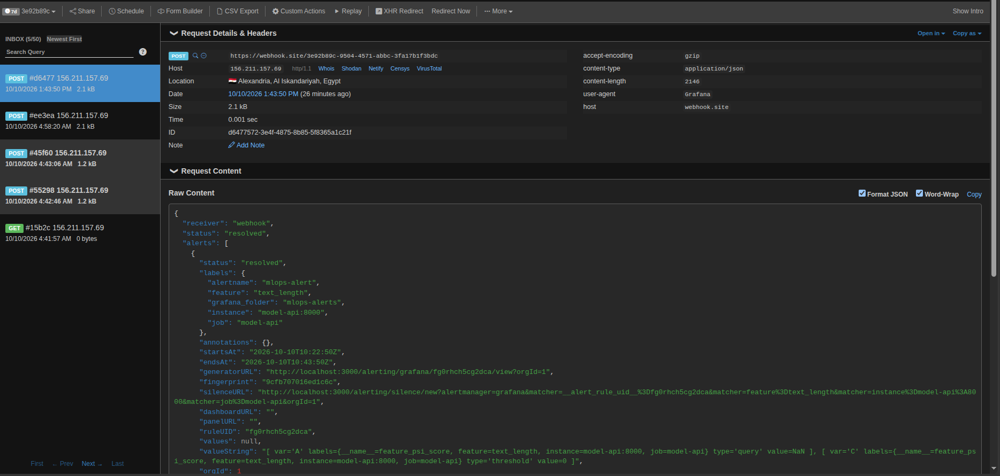
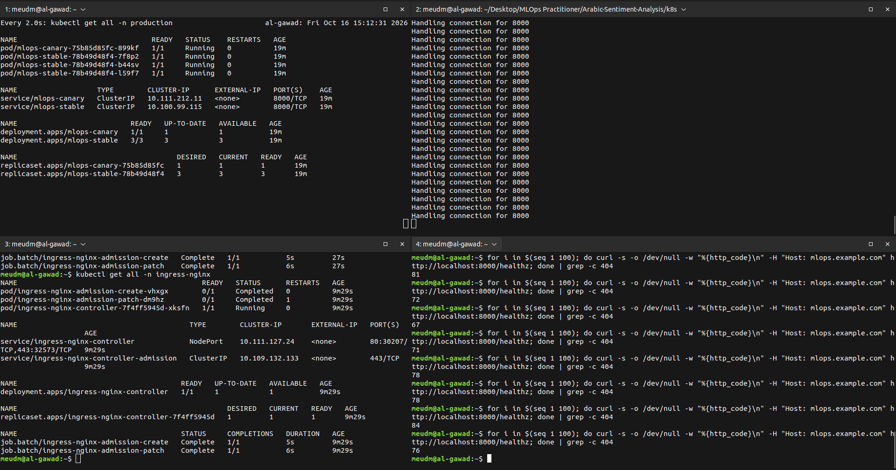

# Arabic Sentiment Analysis

A complete MLOps project for Arabic sentiment classification using a deeplearning model, designed to cover the full lifecycle: data preparation, training, model tracking, serving, monitoring, and deployment automation.

## Project overview

This project builds and serves a sentiment classifier for Arabic text, with emphasis on reproducibility and production readiness. It combines:

- a FastAPI inference API for local serving
- a BentoML production service for scalable model deployment
- MLflow for experiment tracking and model registry
- DVC for data/version pipeline control
- Docker and GitHub Actions for CI/CD and deployment automation
- Prometheus and Grafana for drift and performance monitoring
- Locust for serving load testing

## Architecture



## Project Notes

- **Dataset:** [Bahraini Dialects Dataset](https://data.mendeley.com/datasets/5rhw2srzjj/1)
- **Model optimization:** Not implemented in this project. The reason is not having a GPU.

---

## Quick start

Run the following 3 commands on any machine:

```bash
uv sync
uv run python main.py
curl -X POST http://localhost:8000/predict -H "Content-Type: application/json" -d '{"text":"أنا سعيد جدًا بهذا المنتج"}'
```

## Local setup

### 1) Install dependencies

```bash
uv sync
```

### 2) Start the API

```bash
uv run python main.py
```

### 3) Test the endpoint

```bash
curl -X POST http://localhost:8000/predict \
  -H "Content-Type: application/json" \
  -d '{"text":"أنا راضٍ جدًا عن الخدمة"}'
```

Expected response:

```json
{
  "label": "Positive",
  "confidence": 0.97,
  "model_version": "v1"
}
```

## API endpoints

- `POST /predict` — returns the predicted label, confidence, and model version
- `GET /health` — health check endpoint
- `GET /metrics` — Prometheus metrics export

## Docker

```bash
docker compose up --build
```

This starts the application and monitoring stack defined in the project configuration.

## MLflow tracking and registry

The project uses MLflow to:

- log experiments and metrics
- compare model runs
- register the best model
- promote the selected production model

Useful commands:

```bash
mlflow server --port 5000
```

Model comparison and production promotion artifacts are stored in the `mlartifacts/` folder and can be reviewed from the MLflow UI.

A image comparsion is in `reports/mlflow_coparsion.png` 



## DVC workflow

The project uses DVC to keep the data and pipeline reproducible.

```bash
uv sync
uv run dvc repro -f
uv run dvc status
```
- Note; the reason for cd commands is that I am trying to separete the production from torch dependencies to make docker image building time faster.

This ensures that training and evaluation can be reproduced using the same data and metric configuration.

## Serving

The project exposes the model through two serving paths:

- FastAPI: local inference app in `main.py`
- BentoML: production-style model service in `service.py`

### BentoML

```bash
bentoml serve
```

The BentoML service is intended for production deployment and is exposed through the `predict` endpoint.

## Load testing

Load testing is implemented with Locust.

```bash
locust -f locustfile.py --host=http://localhost:8000
```

Additional headless runs:

```bash
locust -f locustfile.py FastAPIUser --host=http://localhost:8000 --headless -u 10 -r 2 --run-time 1m
locust -f locustfile.py BentoMLUser --host=http://localhost:8000 --headless -u 20 -r 4 --run-time 1m
```

Reports are stored in `reports/`.

## Monitoring and drift detection

The project includes a monitoring stack built around:

- Prometheus for metric collection
- Grafana for dashboards
- PSI-based drift checks for production data using Evidently.

The drift publishing endpoint is available through:

```bash
POST /internal/gauges
```

Prometheus metrics are exposed at:

```bash
GET /metrics
```

Reports and visual artifacts in:

- `reports/drift_report.html`
- `reports/grafana.png`
- `reports/alert.png`
  
#### Grafana Dashboard


#### PSI Alert


## CI/CD

CI is configured in `.github/workflows/ci_cd.yml` and includes:

- Ruff linting
- pytest execution
- Docker build and push workflow

## Canary Rollout

Treated canary rollout on 2 versions of the server with 75/25 percentage. After trying different times the number is nearly correct by curl /healthz which is found only in BentoML and not Fastapi.

V1: Fastapi
V2: BentoML



## Project structure

```text
.
├── .github/                  # CI/CD workflows
├── data/                    # datasets and prepared artifacts
├── docs/                    # project docs and problem statement
├── reports/                 # drift, monitoring, and load-test reports
├── src/                     # model and scoring logic
├── tests/                   # unit and integration tests
├── Dockerfile               # container definition
├── docker-compose.yaml       # service orchestration
├── main.py                  # FastAPI app
├── service.py               # BentoML service
├── pyproject.toml           # Python project dependencies
├── dvc.yaml                 # DVC pipeline definition
├── params.yaml              # configuration parameters
├── locustfile.py            # load tests
├── README.md               # project overview
└── mlartifacts/             # MLflow training artifacts
```
